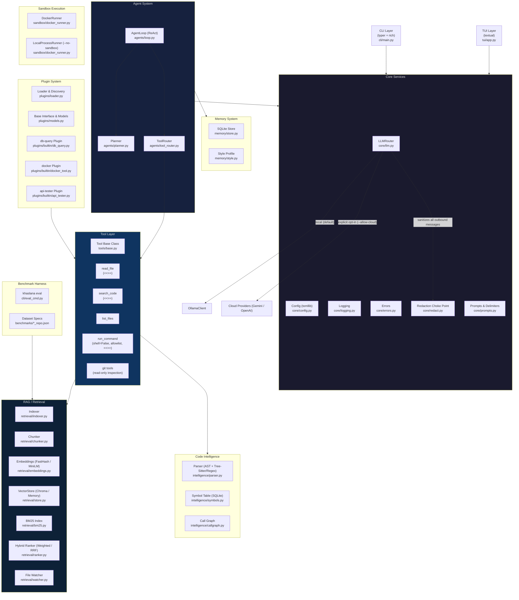

# Khaslana Architecture

## Overview

Khaslana is an open-source, local-first AI developer tool built for code understanding, editing, and intelligence with strict privacy boundaries, deterministic sandbox execution, and hybrid retrieval.

---

## Component Diagram



---

## Data Flow: `khaslana ask "<query>"`

```
User query
    │
    ▼
CLI (typer) → validate args, load Config
    │
    ▼
Retrieval pipeline
  ├─ Embed query → Vector search (Chroma / Memory fallback)
  ├─ BM25 sparse keyword search
  └─ Hybrid rank (Weighted or Reciprocal Rank Fusion) → Top-K chunks
    │
    ▼
Prompt assembly (retrieved chunks formatted with passive delimiters + query)
    │
    ▼
LLMClient Choke Point (`LLMClient.chat` / `LLMClient.stream`)
  └─ Strict Secret Redaction (`core/redact.py`): masks keys, tokens, JWTs, env vars
    │
    ▼
LLMRouter
  ├─ Local: Ollama (default, 100% private)
  └─ Cloud: Gemini / OpenAI (BLOCKED by default; requires explicit --allow-cloud)
    │
    ▼
Streamed output → rich console
```

---

## Data Flow: Agent ReAct Loop (`khaslana debug` / `khaslana analyze`)

```
User Task (e.g. error.log or project analysis)
    │
    ▼
CLI → initialize ToolRegistry + ReAct AgentLoop
    │
    ▼
┌─────────────────────── ReAct Iteration ────────────────────────┐
│ 1. Assemble prompt with tool schemas + history                 │
│ 2. Planner (LLM) emits JSON Action or Final Answer             │
│ 3. JSON Repair / Parser extracts Action                        │
│ 4. Loop Detection checks for repeated tool calls               │
│ 5. Security & Safety Check:                                    │
│    - Commands executed with `shell=False`                      │
│    - Strict read-only allowlist verification                   │
│    - Shell operators, pipes, redirects, subshells rejected     │
│    - Mutating commands require interactive prompt or `--yes`   │
│ 6. Tool execution runs                                         │
│ 7. Tool output wrapped in `<<<UNTRUSTED_CONTENT>>>` delimiters │
│ 8. Observation redacted via `redact()` & appended to history   │
└────────────────────────────────────────────────────────────────┘
    │ (repeated until Final Answer or max iterations)
    ▼
AgentTrace + Final Answer rendered via Rich Live Panel
```

---

## Data Flow: Sandbox Execution (`khaslana fix <file>`)

```
Target File + Test Command
    │
    ▼
CLI (`fix` command) → validate file exists
    │
    ▼
Sandbox Guard:
  ├─ Default: DockerRunner (`sandbox/docker_runner.py`)
  │    └─ Verifies Docker connectivity. If unavailable -> REFUSES execution.
  └─ Override: LocalProcessRunner (requires explicit `--no-sandbox` flag)
    │
    ▼
┌───────────────── Self-Correcting Fix Loop ─────────────────┐
│ 1. Run baseline test command in sandbox                    │
│ 2. If passing -> exit with success, no fix required        │
│ 3. For attempt in 1..max_attempts:                         │
│    a. Assemble prompt with code, test cmd, failure output  │
│    b. LLM proposes full replacement code                   │
│    c. Compute unified diff vs original code                │
│    d. Write fix ONLY to sandbox temp workspace             │
│    e. Re-run tests in ephemeral container (network disabled)│
│    f. If tests pass -> break out of attempt loop           │
│    g. Else feed new failure back for next attempt          │
└────────────────────────────────────────────────────────────┘
    │
    ▼
Display attempt diffs & test results via Rich syntax panels
    │
    ▼
User Confirmation (`--yes` or interactive prompt `Apply this fix to <file>?`)
  ├─ If approved: write verified code to real file in working tree
  └─ If declined / all attempts fail: working tree left 100% untouched
```

---

## Configuration Precedence

```
CLI flags > Environment variables > project .khaslana.toml > ~/.config/khaslana/config.toml > defaults
```

---

## Architecture References

- [`PRIVACY.md`](PRIVACY.md): Redaction rules, cloud fallback controls, and sanitization choke point.
- [`SECURITY.md`](../SECURITY.md): Threat model, shell command allowlist, sandbox isolation, and prompt injection mitigations.
- [`BENCHMARKS.md`](BENCHMARKS.md): Information retrieval benchmark methodology, metrics, and trade-off analysis.
