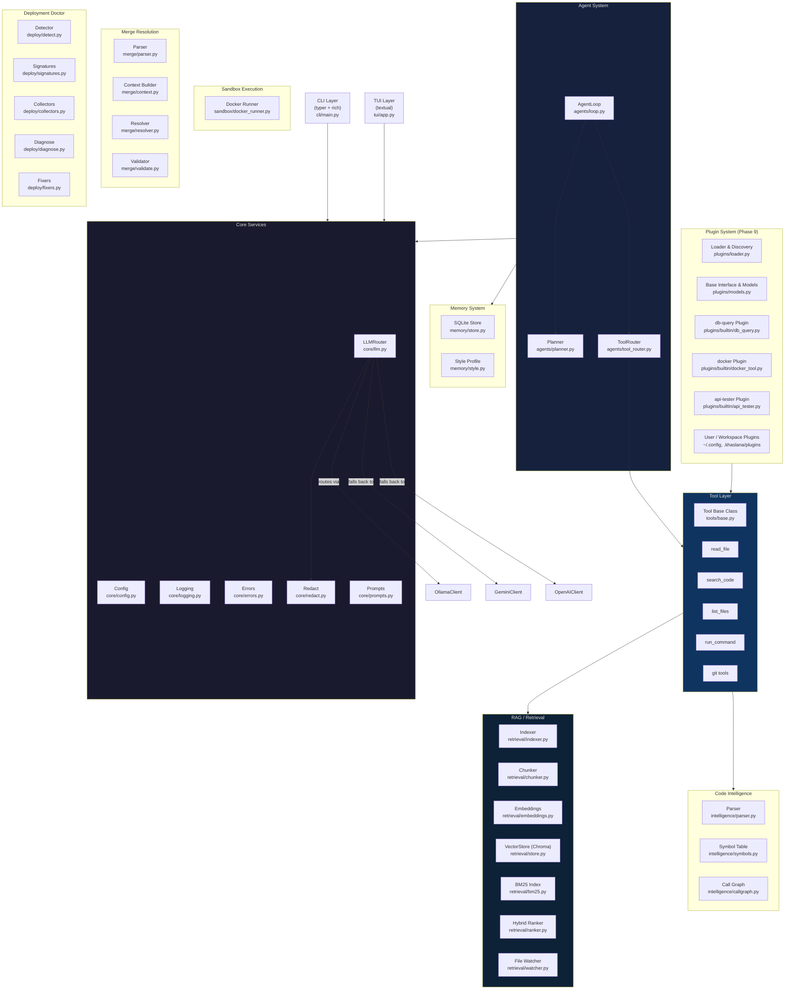

# Khaslana Architecture

## Overview

Khaslana is a production-grade, local-first AI developer tool. It is designed to be modular, testable, and extensible — closer to a platform than a script.

---

## Component Diagram



---

## Data Flow: `khaslana ask "<query>"`

```
User query
    │
    ▼
CLI (typer) → validate args, load Config
    │
    ▼
Redact (sanitize query)
    │
    ▼
Retrieval pipeline
  ├─ Embed query → vector search (Chroma)
  ├─ BM25 keyword search
  └─ Hybrid rank → Top-K chunks (with file:line citations)
    │
    ▼
Prompt assembly (chunks + system prompt + user query)
    │
    ▼
LLMRouter → OllamaClient (primary)
          → GeminiClient (fallback)
          → OpenAIClient (fallback)
    │
    ▼
Streamed output → rich console
```

---

---

## Data Flow: Agent ReAct Loop (`khaslana debug` / `khaslana analyze`)

```
User Task (e.g. error.log or project analysis)
    │
    ▼
CLI → initialize ToolRegistry + ReAct AgentLoop
    │
    ▼
┌───────────────── ReAct Iteration ──────────────────┐
│ 1. Assemble prompt with tool schemas + history     │
│ 2. Planner (LLM) emits JSON Action or Final Answer │
│ 3. JSON Repair / Parser extracts Action            │
│ 4. Loop Detection checks for repeated tool calls   │
│ 5. Tool execution (with confirm for mutating cmds) │
│ 6. Observation appended to history                 │
└────────────────────────────────────────────────────┘
    │ (repeated until Final Answer or max iterations)
    ▼
AgentTrace + Final Answer rendered via Rich Live Panel
```

---

## Data Flow: Git Integration (`khaslana review` / `explain-diff` / `commit-msg`)

```
Git Working Tree (Staged / Branch / Unstaged)
    │
    ▼
Git Inspector (`tools/git.py`)
  ├─ Extract diff patches & changed files
  ├─ Query AST & Symbol Table for changed symbols
  └─ Resolve callers/callees (Context Enrichment)
    │
    ▼
Prompt Assembly (Diff + Symbol Definitions + Call Graph Context)
    │
    ▼
LLM Router (Ollama / Gemini / OpenAI)
    │
    ▼
Output Formatter:
  ├─ Rich Interactive Severity Table (bug / security / perf / style)
  ├─ Structured JSON (--format json)
  └─ GitHub Markdown (--format markdown)
```

---

## Data Flow: Sandbox Execution (`khaslana fix <file>`)

```
Target File + Test Command
    │
    ▼
CLI (`fix` command) → validate file exists
    │
    ▼
DockerRunner (`sandbox/docker_runner.py`)
  ├─ Auto-detect container image (e.g. python:3.11-slim, node:20-slim)
  ├─ Create isolated temporary copy of project directory
  └─ Verify Docker daemon connectivity (fail gracefully if unavailable)
    │
    ▼
┌───────────────── Self-Correcting Fix Loop ─────────────────┐
│ 1. Run baseline test command in sandbox                    │
│ 2. If passing -> exit with success, no fix required        │
│ 3. For attempt in 1..max_attempts:                         │
│    a. Assemble prompt with code, test cmd, failure output  │
│    b. LLM proposes full replacement code                   │
│    c. Compute unified diff vs original code                │
│    d. Write fix ONLY to sandbox temp workspace             │
│    e. Re-run tests in ephemeral container                  │
│    f. If tests pass -> break out of attempt loop           │
│    g. Else feed new failure back for next attempt          │
└────────────────────────────────────────────────────────────┘
    │
    ▼
Display attempt diffs & test results via Rich syntax panels
    │
    ▼
User Confirmation (`--yes` or prompt `Apply this fix to <file>?`)
  ├─ If approved: write verified code to real file in working tree
  └─ If declined / all attempts fail: working tree left 100% untouched
```

---

## Data Flow: Memory System & Style Learning

```
User Query / Command / Accepted Fix
    │
    ▼
CLI Execution (`ask`, `fix`, `feedback`)
    │
    ├─ Semantic Recall:
    │    Embed incoming query → Vector similarity search in SQLite `queries`
    │    Retrieve top-k relevant past interactions
    │
    ├─ Style Profile Loading:
    │    Load cached `StyleProfile` (or learn via AST analysis over codebase)
    │    Inject formatting, naming conventions, docstring patterns into system prompt
    │
    ▼
LLM Prompt Assembly with Style & Relevant Historical Context
    │
    ▼
LLM Generation / Stream
    │
    ▼
Persistence:
    ├─ Save query + response + query embedding into SQLite `queries`
    ├─ On `khaslana fix`: record proposal, diff, test results, accepted flag
    ├─ On `khaslana feedback good|bad`: record feedback rating against interaction ID
    └─ On accepted patches: refine `StyleLearner` rule weights
```

---

## Data Flow: Background Indexing & Live File Watcher

```
Filesystem Event (Modify / Create / Delete / Move)
    │
    ▼
Watchdog Observer (`retrieval/watcher.py:RepoWatcher`)
    │
    ▼
Debounced Change Handler (`DebouncedEventHandler`)
    ├─ Filter gitignored & internal paths (.git, .khaslana, __pycache__)
    ├─ Buffer modified & deleted file paths
    └─ Debounce timer (default: 0.5s) to coalesce rapid editor save bursts
    │
    ▼
Incremental Updater (`IncrementalUpdater`)
    ├─ Content Hash Check: SHA-256 vs stored hash in `.khaslana/index_state.json`
    │    └─ Skip re-indexing if content is identical (e.g. touch/mtime changes)
    ├─ For modified files:
    │    ├─ Delete old chunks from Vector Store (`ChromaVectorStore`)
    │    ├─ Re-parse AST and update SQLite Symbol Table (`SymbolTable`)
    │    ├─ Re-chunk source code into semantic units (`CodeChunker`)
    │    └─ Re-embed new chunks and upsert to Vector Store
    └─ For deleted files:
         ├─ Delete chunks from Vector Store
         ├─ Delete symbols, imports, and calls from SQLite Symbol Table
         └─ Remove record from `.khaslana/index_state.json`
    │
    ▼
Daemon Management (`DaemonManager`)
    ├─ Runs detached background worker process via `khaslana daemon start`
    ├─ Persists PID to `.khaslana/daemon.pid` and logs to `.khaslana/daemon.log`
    └─ Automatically checks staleness and refreshes on `khaslana ask`
```

---

## Data Flow: Plugin Discovery, Registration & Isolation

```
Discovery Sources
  ├─ Built-ins: db-query, docker, api-tester
  ├─ Python Entry Points: khaslana.plugins
  ├─ User Directory: ~/.config/khaslana/plugins/
  └─ Workspace Directory: .khaslana/plugins/
       │
       ▼
PluginLoader (`plugins/loader.py`)
  ├─ Module Import & Spec Loading (Isolated with try/except)
  │    └─ Syntax/Import error → captured as `_ErrorPlugin` (no app crash)
  ├─ Schema Extraction & Tool Registration (`register(registry)`)
  └─ Toggles Check: read `~/.config/khaslana/plugins.json`
       │
       ▼
ToolRegistry (`tools/base.py`)
  └─ Active tools registered: db_query, docker_inspect, api_test, custom tools
       │
       ▼
Agent ReAct Loop / CLI Inspection (`khaslana plugins list|info|enable|disable`)
  └─ Prompt injection with Pydantic JSON schemas → Tool execution with error traps
```

---

## Configuration Precedence

```
CLI flags > Environment variables > project .khaslana.toml > ~/.config/khaslana/config.toml > defaults
```

---

## Key Design Decisions

See [`DECISIONS.md`](DECISIONS.md) for rationale behind architectural choices.

---

## Phase Status

| Phase | Feature                   | Status         |
|-------|---------------------------|----------------|
| 0     | Foundation + LLM routing  | ✅ Done        |
| 1     | RAG System                | ✅ Done        |
| 2     | Hybrid Retrieval          | ✅ Done        |
| 3     | Code Intelligence         | ✅ Done        |
| 4     | Agent System              | ✅ Done        |
| 5     | Git Integration           | ✅ Done        |
| 6     | Sandbox Execution         | ✅ Done        |
| 7     | Memory System             | ✅ Done        |
| 8     | Background Indexing       | ✅ Done        |
| 9     | Plugin System             | ✅ Done        |
| 10    | TUI                       | 🔲 TODO        |


