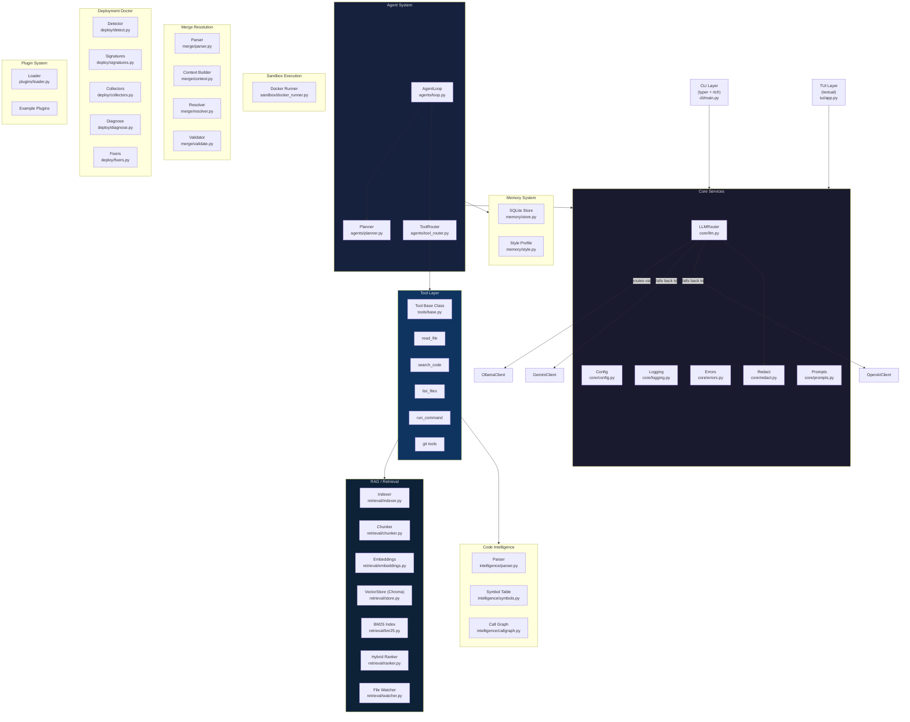

# Khaslana Architecture

## Overview

Khaslana is a production-grade, local-first AI developer tool. It is designed to be modular, testable, and extensible — closer to a platform than a script.

---

## Component Diagram



---

## Data Flow: `khaslana ask "<query>"`

```
User query
    │
    ▼
CLI (typer) → validate args, load Config
    │
    ▼
Redact (sanitize query)
    │
    ▼
Retrieval pipeline
  ├─ Embed query → vector search (Chroma)
  ├─ BM25 keyword search
  └─ Hybrid rank → Top-K chunks (with file:line citations)
    │
    ▼
Prompt assembly (chunks + system prompt + user query)
    │
    ▼
LLMRouter → OllamaClient (primary)
          → GeminiClient (fallback)
          → OpenAIClient (fallback)
    │
    ▼
Streamed output → rich console
```

---

## Configuration Precedence

```
CLI flags > Environment variables > project .khaslana.toml > ~/.config/khaslana/config.toml > defaults
```

---

## Key Design Decisions

See [`DECISIONS.md`](DECISIONS.md) for rationale behind architectural choices.

---

## Phase Status

| Phase | Feature                   | Status  |
|-------|---------------------------|---------|
| 0     | Foundation + LLM routing  | ✅ Done |
| 1     | RAG System                | ✅ Done |
| 2     | Hybrid Retrieval          | 🔲 TODO |
| 3     | Code Intelligence         | 🔲 TODO |
| 4     | Agent System              | 🔲 TODO |
| 5     | Git Integration           | 🔲 TODO |
| 6     | Sandbox Execution         | 🔲 TODO |
| 7     | Memory System             | 🔲 TODO |
| 8     | Background Indexing       | 🔲 TODO |
| 9     | Plugin System             | 🔲 TODO |
| 10    | Merge Conflict Resolution | 🔲 TODO |
| 11    | Deployment Doctor         | 🔲 TODO |
| 12    | TUI                       | 🔲 TODO |
