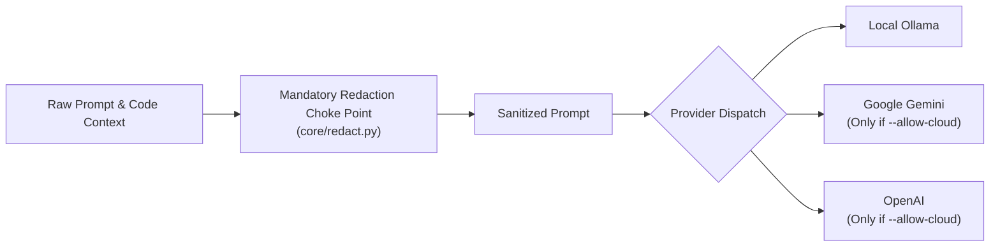

# Khaslana Privacy Architecture & Data Governance

Khaslana is designed with a **local-first** privacy posture. This document outlines where data flows by default, how external LLM interactions are controlled, and the precise security boundaries governing secret redaction.

---

## 1. Data Flow by Default: 100% Local Execution

By default, all code analysis, AST parsing, symbol indexing, retrieval, and LLM inference run strictly on your local machine:
- **LLM Engine**: Queries and prompts are routed to your locally hosted Ollama server (`http://localhost:11434`), or custom offline models. No source code or prompts leave your system.
- **RAG & Vector Storage**: Chunks and embeddings are stored in a local SQLite database or local ChromaDB directory (`.khaslana/index/`). No embeddings are shipped to external vector SaaS databases.
- **Code Intelligence**: SQLite symbol databases and static call graphs are generated and retained exclusively on the host filesystem under `.khaslana/symbols.db`.

---

## 2. Cloud Fallback & Explicit User Consent

Khaslana supports cloud LLM providers (Google Gemini, OpenAI) as fallback options when local models time out or encounter resource limits. However, **cloud fallback is strictly disabled by default**:

```toml
# In .khaslana.toml or ~/.config/khaslana/config.toml
[llm]
allow_cloud_fallback = false  # Default: strictly blocked
```

### Fallback Behavior:
- **When `allow_cloud_fallback = false` (default)**: If your local Ollama instance is unreachable or times out, Khaslana immediately halts and surfaces an actionable error. It **will never silently transmit code** to Google or OpenAI.
- **Enabling Cloud Fallback**: You may permit cloud fallback on a per-command basis using the `--allow-cloud` flag:
  ```bash
  khaslana ask "Explain this function" --allow-cloud
  ```
  Or permanently via configuration:
  ```bash
  khaslana config set llm.allow_cloud_fallback true
  ```
- **Visible Privacy Warning**: Whenever a command falls back to an external cloud provider, a warning is printed directly to `stderr`:
  ```
  [Privacy Warning] Local LLM provider 'ollama' failed. Falling back to cloud provider 'gemini'. Redacted code context will be transmitted to Gemini.
  ```

---

## 3. Mandatory Secret Redaction Choke Point

Before any message payload is dispatched to any LLM client (local or cloud), it passes through a single, mandatory choke point in `LLMClient`:



Even if individual provider clients (`GeminiClient`, `OpenAIClient`) are instantiated directly by plugins or custom scripts, they inherit from `LLMClient.chat()` / `LLMClient.stream()`, ensuring unredacted payloads cannot be dispatched.

---

## 4. Redaction Mechanics & Known Limitations

Khaslana employs two complementary layers of secret detection:

1. **Deterministic Pattern Matchers**:
   - Private key blocks (RSA, OpenSSH, EC, generic PEM).
   - Provider API keys (OpenAI `sk-...`, Anthropic `sk-ant-...`, Google `AIza...`).
   - Cloud Credentials (AWS Access Key IDs `AKIA...`, `ASIA...`).
   - Source control tokens (GitHub Classic `ghp_...` and Fine-Grained `github_pat_...`, Slack `xox...`).
   - Authentication tokens (JWTs, Bearer tokens).
   - Connection strings (PostgreSQL, MySQL, MongoDB, Redis URIs masking user credentials).
   - Environment variables & assignments (`.env` variables matching `*_SECRET`, `*_KEY`, `*_PASSWORD`, `*_TOKEN`).

2. **Shannon Entropy Scanning**:
   - Unrecognized strings exceeding 24 characters with Shannon entropy $\ge 3.8$ (or $\ge 3.2$ for hexadecimal tokens) are flagged as high-entropy secrets and redacted.
   - Non-secret tokens with known structural formats (such as 40-character Git commit SHAs, 64-character SHA-256 file hashes, and RFC 4122 UUIDs) are protected against false-positive redaction.

> [!WARNING]
> **Redaction is Best-Effort**:
> Automated secret redaction is fundamentally heuristic. While regex and entropy filters catch common credential formats, Khaslana **cannot guarantee 100% detection** of arbitrarily structured custom tokens, proprietary secrets, or low-entropy passwords.
> Always ensure sensitive production credentials are kept in secure secret managers rather than plain source code files.
